<picture>
  <source media="(prefers-color-scheme: dark)" srcset="assets/maker-hero-dark.svg">
  <source media="(prefers-color-scheme: light)" srcset="assets/maker-hero-light.svg">
  
</picture>

<br>

> **I'm a product manager who stopped waiting for someone else to build.**
> By day I decide what gets built and why. By night I build it myself: research, spec, design, code and launch.
> Solo, with AI as my pair programmer, and in public.

<br>

<picture>
  <source media="(prefers-color-scheme: dark)" srcset="assets/loop-dark.svg">
  <source media="(prefers-color-scheme: light)" srcset="assets/loop-light.svg">
  
</picture>

## `01` · What I believe

<sub>Strong opinions, loosely held.</sub>

| # | Belief | Why it matters |
|:-:|---|---|
| **B1** | **A spec is cheaper than code.** | Even when AI writes the code. Thinking on paper is still the fastest way to build less of the wrong thing. |
| **B2** | **AI made building cheap. Judgement is the new bottleneck.** | Anyone can ship an app now. Knowing which one to ship, and what to leave out, is the hard part. |
| **B3** | **Small is a feature.** | If one person can't maintain it, it isn't an MVP. |
| **B4** | **Unknown is not zero.** | Honest numbers, or no numbers. Every metric says where it came from. |
| **B5** | **Kill fast, keep few.** | Most ideas should die. The skill is noticing early and saying it out loud. |

## `02` · What I'm building

| | Project | What it is | Built with | Status |
|---|---|---|---|---|
| 🌙 | **Sleep app** *(name pending)* | Apple Watch sleep data turned into evidence-based suggestions and tiny personal experiments. No scores, no sleep anxiety. | `SwiftUI` `HealthKit` | 🟠 discovery |
| 🏋️ | **Training app** *(name pending)* | A training log that keeps up with your workout: last week's exact set, a rest timer and honest PRs. | `React Native` `Expo` | 🟠 building |
| ✦ | **aritxa.dev** | Home for everything I make, with a commit map pulled straight from git. | `HTML` `CSS` `JS` | 🟣 going live |
| 🧰 | **PM toolkit** | Free tools for product people: RICE calculator, one-pager builder and a kill-or-keep feature audit. | `vanilla JS` | 🟢 shipped |

```ts
// open-metrics.ts: no rounding up
export const nightShift = {
  appsInFlight:   2,
  appsLaunched:   0,        // not yet. soon.
  mrr:            "$0",     // the real number goes here when it moves
  pairProgrammer: "AI",
  sleep:          "ironic", // building a sleep app at 1 a.m.
};
```

## `03` · Talk to me about

<table>
<tr>
<td width="33%" valign="top">

**🧭 Product craft**<br>
<sub>Discovery, specs, prioritisation, and saying no with data.</sub>

</td>
<td width="33%" valign="top">

**🤖 Building solo with AI**<br>
<sub>How a PM goes from idea to App Store without a team. What works, what breaks.</sub>

</td>
<td width="33%" valign="top">

**💡 Your MVP**<br>
<sub>Bring a half-built app. I'll bring a PM's eye and honest feedback.</sub>

</td>
</tr>
</table>

<p align="center">
  <a href="https://aritxa.dev"></a>
  &nbsp;
  <a href="https://github.com/AritxaTroyano?tab=repositories"></a>
</p>

<p align="center"><sub><code>PRD-001</code> · owner: me · status: shipping · next review: when something ships</sub></p>
